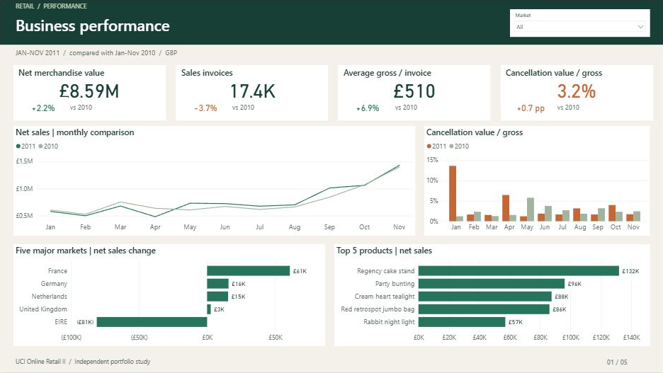

# Revenue Quality Intelligence

A retail analytics portfolio case study using **SQL, Python and Power BI** to investigate revenue quality, repeat purchasing and commercial concentration across **1,067,371 invoice lines**.

**Business question:** how reliable are reported growth and retention after accounting for cancellations, duplicate records, missing identities and incomplete observation periods?

[Power BI report](powerbi/RevenueQuality.pbix) · [Findings](docs/insights.md) · [SQL analyses](sql/advanced_analysis/) · [KPI definitions](docs/kpi_definitions.md)



## Findings

- **£18.54m net merchandise value:** £19.08m gross sales less £545,530 cancellation postings.
- **41.3% 90-day repeat rate:** 1,458 of 3,533 eligible identified buyers with fully observed follow-up.
- **63.5% of identified-customer gross sales** came from the highest-spending customer decile.
- **13.0% of gross sales lacked customer identity**, limiting CRM coverage.
- **22,523 overlapping source rows** were reconciled before analysis; ambiguous within-partition repeats remain in the baseline with a sensitivity scenario.

[Ten findings](docs/insights.md) connect evidence, alternative explanations and proposed decisions. Recommendations prioritize finance reconciliation, customer identification, account research and a future controlled CRM experiment. No realized business impact is claimed.

## Analytical work

| Stage | Work | Evidence |
|---|---|---|
| Preparation | Verified the workbook; typed and classified sales, cancellations and exceptions | [Method](docs/methodology.md), [quality report](reports/data_quality.md) |
| SQL modelling | Created facts, dimensions, lifecycle, segments and cohort marts in DuckDB | [Transformations](sql/transformations/), [model](docs/data_dictionary.md) |
| Analysis | Wrote 24 SQL analyses using joins, CTEs, windows, cohorts, concentration and basket affinity | [Queries](sql/advanced_analysis/), [results](reports/query_results/) |
| Python | Automated ingestion, quality checks, exports and descriptive statistical intervals | [Scripts](scripts/), [tests](tests/) |
| Power BI | Built typed Power Query imports, seven relationships, 45 DAX measures and five native pages | [Project source](powerbi/RevenueQuality.pbip), [validation](powerbi/validation.md) |
| Communication | Converted evidence into practical, qualified recommendations | [Recommendations](docs/recommendations.md) |

The report answers five questions: how much sales value remains after cancellations; whether customers buy again; which products drive value; whether the numbers can be trusted; and what to do next. The overview compares Jan-Nov 2011 with the same months in 2010 using four comparative KPIs, monthly sales and cancellation charts, market changes and leading products. The customer grid uses larger cells for 2011 cohorts and six later months. Finance visuals support filtering; the customer page clearly labels its fixed snapshot.

## Open the report

Open **`powerbi/RevenueQuality.pbix` in Power BI Desktop**. Its imported data is included, so viewing does not require running Python. Open `powerbi/RevenueQuality.pbip` for editable text sources. [Refresh instructions](powerbi/README.md).

The native five-page report has been verified in Desktop. The portable PBIX includes its imported model; the editable PBIP is also included.

GitHub displays documentation and screenshots; download the PBIX and open it in Desktop to interact with it. No Power BI Service deployment is included.

## Reproduce

Python 3.12 was used. From the repository folder:

```powershell
python -m venv .venv
.venv\Scripts\python.exe -m pip install -r requirements.txt
.venv\Scripts\python.exe scripts/pipeline.py
.venv\Scripts\python.exe scripts/build_powerbi.py
.venv\Scripts\python.exe -m pytest tests -q
```

On macOS/Linux use `.venv/bin/python`. The pipeline downloads and checksum-verifies the official source, builds the warehouse and writes CSV imports. Allow approximately 1 GB for local data. Raw data, databases and full CSV exports are Git-ignored. The included CI workflow validates the analytical layer; it does not run Power BI Desktop.

## Scope and attribution

Complete-month reporting covers December 2009–November 2011. Net merchandise value is a sales-posting metric, not profit. Cancellations cannot be reliably matched to original sales. First observed is not necessarily first-ever purchase. Missing IDs remain in finance totals and are excluded from cohorts. Associations are descriptive, not causal.

Chen, D. (2012). *Online Retail II*, UCI Machine Learning Repository. [Dataset/DOI](https://doi.org/10.24432/C5CG6D), [CC BY 4.0](https://creativecommons.org/licenses/by/4.0/). Data was transformed, pseudonymized and aggregated. [Data license](DATA_LICENSE.md); code: [MIT](LICENSE).

## Reading the dashboard

The management pages focus on Jan-Nov 2011; the historical findings above cover Dec 2009-Nov 2011. [Dashboard guide and metric definitions](docs/dashboard_guide.md). The Forest and Linen visual theme is a custom portfolio identity; the source does not identify the retailer.
