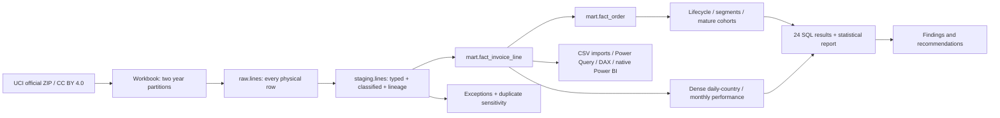

# Architecture and lineage

DuckDB is the implemented database. It gives a portable analytical warehouse, exact decimals, window functions, Parquet caching, enforced keys and no server dependency at this scale. PostgreSQL was considered; no local PostgreSQL server/client is available, and this batch workload does not need concurrent transactional writes. SQL is explicitly DuckDB dialect; porting `QUALIFY`-style patterns (where used), regex, date arithmetic, `arg_max`, variables and COPY requires review. No PostgreSQL implementation is claimed.

Five ordered SQL transformation/mart files create a star-shaped model plus lifecycle aggregates. Twenty-four separate analysis files consume it. dbt is not required here: a small explicit runner executes SQL in order and assertions verify contracts. This sacrifices dbt's graph/catalog ecosystem while retaining visible lineage and testability. dbt is a future migration when team size/deployment warrants it.

The transformation transaction rolls back model changes on failure. Raw acquisition happens before it. Quality gates run before analysis/exports; failed quality gates exit nonzero. Raw and model states can still exist for diagnosis. Exports are local batch products; this is not a concurrent production serving system. During a rebuild, close warehouse readers. Reruns reuse the checksum-matched Parquet cache; `--refresh` forces official download and workbook parsing. There is no incremental ingestion claim.

The sheets overlap on 1–9 December 2010: 22,523 earlier-partition rows are superseded after full eight-field multiset equality verification, preserving within-sheet multiplicities. The official workbook SHA-256, byte size, sheet row counts and source URL are recorded in `reports/source_manifest.json`. `line_id` combines partition ordinal and physical Excel row, preserving physical identity without pretending it is an original business line key. Customer IDs are deterministically hashed for presentation; this is pseudonymization, not a security guarantee against reidentification. The raw ID exists only in raw/staging, not analytical CSV exports.

Primary keys on dimensions and line fact are enforced; physical foreign keys on the line fact refer to date, customer, product and transaction country. Other mart relationships are checked logically. Lookup indexes on invoice/customer support drill-down; columnar scans often dominate aggregates, so no unsupported speedup claim is made. `reports/query_plan.txt` captures actual EXPLAIN ANALYZE for the affinity query. `run_manifest.json` records result rows and elapsed query times including DataFrame materialization/CSV output.
