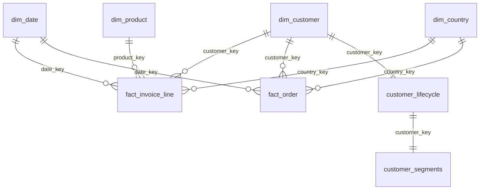

# Model, grains and dictionary

The original workbook has eight fields and two time partitions. It does **not** provide independent order/customer/product tables. The following dimensions and facts are derived transparently from that one source. All column names/types/nullability are exported from the actual engine to [schema_columns.csv](schema_columns.csv).

|Source field|Typed field|Meaning / policy|
|---|---|---|
|Invoice|invoice_no|Business invoice number; C prefix indicates cancellation|
|StockCode|stock_code / product_key|Trimmed uppercase code; core merchandise regex `[0-9]{5}[A-Z]*` is an analyst rule|
|Description|description / product_name|Nullable text; latest non-null observed description is display only|
|Quantity|quantity|Signed integer units; negative C-prefixed lines can enter cancellation fact|
|InvoiceDate|invoice_ts / date_key|Source timestamp; no timezone supplied, retained as naive local business time|
|Price|unit_price|GBP unit price cast DECIMAL(18,4)|
|Customer ID|source_customer_id / customer_key|Nullable source identifier; hash to 16 hex chars, UNKNOWN sentinel for missing|
|Country|country_key|Transaction-level country; trim blanks, Unknown sentinel if necessary|

|Table|Grain / key|Important columns|
|---|---|---|
|raw.lines|Physical workbook row, line_id|Unchanged source values plus source_sheet/source_row/line_id|
|staging.lines|Same physical row|is_cancel_invoice, is_merchandise, duplicate_group_size/ordinal, line_status, amount_pence|
|dim_date|One contiguous calendar day; PK date_key|Year/month/name, month_start, complete-period flag|
|dim_customer|One pseudonymous ID incl UNKNOWN; PK customer_key|first_seen across any line, observed_country_count; not acquisition date|
|dim_product|One merchandise code; PK product_key|Latest observed description and description-variant count; no invented category|
|dim_country|One observed transaction country; PK country_key|No ISO-code/region inference|
|fact_invoice_line|One eligible physical sale/cancellation line; PK line_id|4 enforced FKs, invoice_no, timestamp, signed units, Decimal unit_price, signed integer pence|
|fact_order|One sale invoice/customer/country group|gross_pence, line_count, distinct_products, units; one customer/country/date contract checked. Earliest timestamp defines order time; line timestamps are retained. 82 source invoices span up to 9 minutes.|
|customer_lifecycle|One identified purchasing customer before cutoff|first_purchase_date, cohort_month, last_purchase_date, orders, gross_pence, first-order breadth/value, days_to_second_order, recency_days, after_warmup, fully_observed_90d|
|customer_segments|Same lifecycle customer snapshot|Rules-based segment plus R/F/M quintiles; customer_key provides deterministic tie splitting|
|cohort_retention|First-observed month × observable monthly age|cohort_size, activity_month, active_customers, retention_rate; future cells absent|
|daily_country|Contiguous calendar day × country|Zero-filled gross/cancellation/net pence and invoice count|
|monthly_performance|One complete calendar month|Aggregate value, sale invoices and gross AOV|
|reporting_policy|One configuration row|Exclusive cutoff persisted so reopened views remain stable|

The line fact has enforced FKs; order/lifecycle relationships in the diagram are logical and validated by data contracts/pytest. There is no order-to-line fact relationship in Power BI: common dimensions independently filter each fact, avoiding ambiguous paths and value fanout. Cohort retention and aggregate reconciliation tables are disconnected semantic tables with their own filter scope.
